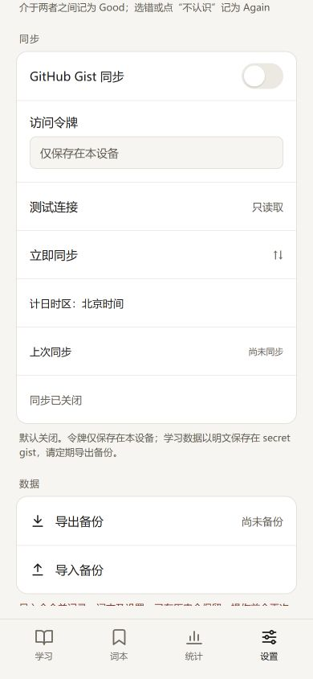

# 同步第二轮验收

日期：2026-11-03。第一轮已先提交为 `e7a1f11`（Sync round 1: UUIDs, events, merge engine）。本轮实现 Gist 传输、同步设置及整个 App 的北京时间规则；未安装依赖、未提供真实令牌、未向真实 GitHub Gist API 请求。只联网查了用户指定的官方文档与 Actions release。

## 实现

- 一个 secret gist，描述标记 `[one-word-sync:v1]`；`one-word-meta.json` 只在创建时写入，固定 Asia/Shanghai。分页发现、格式/版本/来源校验，重复库报告歧义；已绑定库消失不自动另建。
- 先完整读取全部设备文件，任何顶层或单文件截断都在上传及本机合并前停止。只请求 api.github.com，重定向使用 error，不跟随 raw_url，不缓存 API；令牌只出现在 Authorization 头。
- 只 PATCH 本设备当前月文件。月份表示发布月份，导入旧历史和跨月补录保留原始作答时间、UUID 与来源，发布到当前月；已存在的其他设备文件和旧月份不删除。整文件 UTF-8 超过 512 KiB 时拆分，包含封装计字节。
- 请求在学习事务之外执行。上传后事务合并，再检查是否有期间新产生的事实，必要时安排下一轮。上传已经到达服务端但响应丢失时，下次先读取远端，按 UUID 去重恢复。
- 联网启动、回首页、恢复联网和手动触发；500 ms 防抖、自动请求至少间隔 3 秒。Web Locks 跨标签页排他，不支持时使用 IndexedDB 租约；请求前续约，单请求 20 秒超时。状态通过不含令牌的 BroadcastChannel 消息通知其他标签页重新读取本机配置。
- 网络/服务器错误指数退避并有抖动，遵守 Retry-After、X-RateLimit-Remaining 和 Reset，手动按钮也不能绕过冷却。身份或权限等非暂时错误不安排定时重试。失败仅在设置区显示，不阻止本地学习。
- 设置区复用列表、开关及 tokens，默认关闭，密码框、只读测试连接、立即同步、上次成功时间和状态；只显示“计日时区：北京时间”，没有时区选择。令牌、绑定和租约不进入 JSON 备份或共享数据。
- 整个 App 无论是否开启同步都按 Asia/Shanghai 计日。旧库和备份的日期及派生状态重新计算，原始作答时间戳和 UUID 不变；可恢复的本机题目保留。第一轮的泛用时区辅助函数仍可显式处理旧时区及测试 DST，App 入口统一固定北京时间。

## 验证

`pnpm test`：30 个测试文件、195 项通过。`pnpm run build`：TypeScript、Vite 与 PWA 生成通过。没有修改 package.json 或 pnpm-lock.yaml。

本机 PATH 中的全局 pnpm 启动器曾尝试联网解析版本而失败；实际测试和构建改为直接运行 Codex 本机已有的 pnpm 11.25.0，不安装、不改依赖。README 中仍统一使用 pnpm 命令。

模拟 GitHub API 覆盖：首次创建、第二设备发现、多个有效库、401/403/404、已绑定库消失、缺少写权限、限流期限及成功响应耗尽额度、网络中断、上传成功但响应丢失、列表/顶层/文件截断、外域分页拒绝、6000 条记录拆分、上传期间继续作答。测试不调用全局网络 fetch。

控制器覆盖：默认关闭零请求、离线零请求、只读连接测试不创建/合并、启动/首页触发防抖、共享锁、持久化退避、手动操作不能提前重试、关闭时取消。时间测试覆盖旧东京 day 字段重算、北京时间零点、系统时区切换为东京/洛杉矶/UTC 时仍使用同一边界，原始时间戳不变。第一轮的三设备代数性质及原功能单元测试继续通过。

浏览器使用仅监听 127.0.0.1:5193 的本地服务，打开 `/one-word/tests/browser/sync-gist.html`，使用 `one-word-gist-test-*` 独立数据库及模拟 API，10 项真实 IndexedDB 检查通过：

1. 同 schema 的旧东京库重算日期，保留时间戳、UUID、本机反馈。
2. 本机旧时区与绑定字段统一为 Asia/Shanghai。
3. 模拟 PATCH 挂起期间，仍可提交新作答。
4. 两个独立数据库通过同一个模拟 gist 收敛。
5. 只创建一个 secret gist，后续 PATCH 不修改 meta。
6. 上传期间新增的作答在随后一轮进入设备文件。
7. 真实数据库中的令牌哨兵不进入备份或共享数据。
8. 不同数据库连接共用真实 Web Lock。
9. IndexedDB 租约备用路径可排他并续约。
10. 实际外域 fetch 尝试数为零，成功同步时间落库。

结果见 [database-checks.txt](artifacts/sync-gist/database-checks.txt)。真实 App 的设置页以 390×844 检查默认关闭及固定时区；模拟设置页验证测试连接后“尚未同步”，立即同步后显示成功时间（北京时间 2026/11/03 23:30）。界面状态记录见 artifacts/sync-gist。

第一轮本地合并浏览器验收已改用北京时间并回归，23 项全部通过，结果见 [merge-regression.txt](artifacts/sync-gist/merge-regression.txt)。

## Actions 官方发布核查

未安装 actionlint，逐项人工检查 workflow：push main / 手动触发、Node 24、pnpm 版本从 packageManager 读取、frozen install → test → build、上传 dist、deploy 依赖 build、pages:write / id-token:write、github-pages environment 和 deployment 输出引用均正确。只升级用户指定的三个主版本，没有执行远端 workflow。

- [configure-pages v6.0.0](https://github.com/actions/configure-pages/releases/tag/v6.0.0)：release 明确升级至 Node 24。
- [upload-pages-artifact v5.0.0](https://github.com/actions/upload-pages-artifact/releases/tag/v5.0.0)：最新版主版本 v5，[action.yml](https://github.com/actions/upload-pages-artifact/blob/v5/action.yml) 内部引用 upload-artifact v7；它是 composite action。
- [deploy-pages v5.0.0](https://github.com/actions/deploy-pages/releases/tag/v5.0.0)：release 明确使用 Node 24，当前最新主版本仍 v5，最新 release v5.0.1。
- [Gist API](https://docs.github.com/en/rest/gists/gists)：核实 classic gist scope、fine-grained Gists 用户写权限和截断规则；[限流文档](https://docs.github.com/en/rest/using-the-rest-api/rate-limits-for-the-rest-api)：核实重试响应头处理。

## 实际环境的验收范围

按用户要求，真实 GitHub 读写、账号权限、浏览器 CORS 响应头及线上 Pages workflow 留给用户验收。README 已写令牌创建、两设备顺序开启、更新过期令牌及定期导出步骤。

同时首次启用两台设备仍可能各自创建一个 gist；下一次发现会报告歧义，因此先让第一台完成，再启用第二台。GitHub 超过文件列表返回上限时本实现停止，不扩展为多 gist。secret gist 明文存储，离线同时学习仍可能先超出共享额度；事实保留并在合并后重算。
