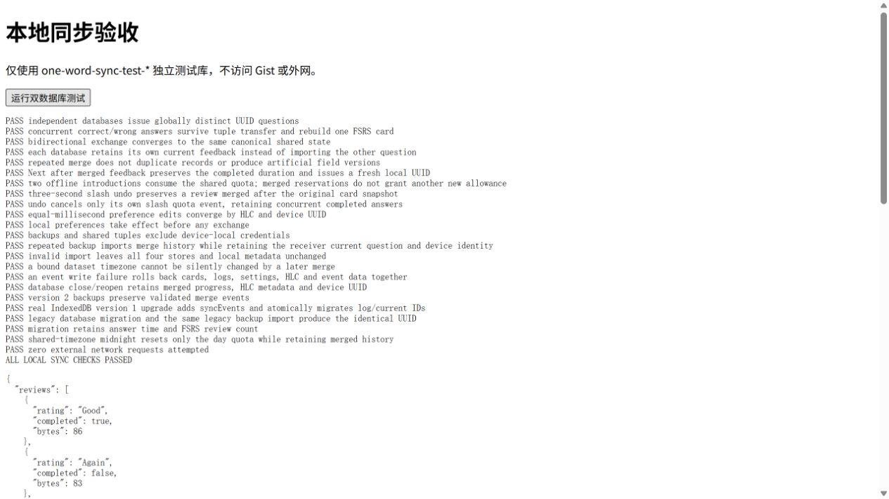

# 同步第一轮：本地基础验收

验收日期：2026-11-03。本轮没有请求外网、安装依赖、访问 GitHub 或实现 Gist 客户端。浏览器验收仅使用 `127.0.0.1:5191` 的开发服务和独立测试数据库，不读取或修改日常使用的 `one-word` 数据库。改动未提交。

## 完成范围

- IndexedDB schema 2：保留 cards、reviewLogs、settings，新增 syncEvents；设备 UUID、HLC 和时区绑定放在 settings 的本机记录，不进入共享数据或备份。
- 新作答 UUIDv4，旧作答确定性 UUIDv5 迁移；当前反馈引用一并更新。复制旧库与导入同一旧备份得到相同 UUID。
- 事实并集、HLC 字段版本、固定 FSRS 配置重放、斩及撤销补偿、统一时区的每日额度和统计。未开始的预约和当前题不从其他设备导入。
- 备份 v2；兼容 v1，导入改为合并，重复导入不重复计数。格式错误、冲突或写入异常均不清空现有数据。
- 设备月文件的本地紧凑编解码；完整 UTF-8 文件含封装不超过 524288 字节，超过后追加月内序号。没有远端读写。
- SPEC、AGENTS、README 和原数据库验收脚本同步更新。

## 自动验证

`pnpm test`：27 个文件、171 项测试全部通过；`pnpm run build`：TypeScript 检查、Vite 构建及 PWA 生成通过。

新增用例覆盖：

- 三设备的幂等、交换律及结合律：30 组数据，全部 6 种合并顺序，左右结合及重复合并；同时检查派生卡片与日志一致。
- UUIDv5 的 RFC 标准向量、确定性迁移、可后补时长不改变 ID、旧撞号的可区分内容及历史缺失时安全拒绝。
- 同毫秒逻辑计数、设备/事件 UUID 决胜、接收远端 HLC 后继续修改、系统时钟回拨。
- 并发作答、斩/撤销、生词本及设置的独立版本；撤销不覆盖后来合并的作答；固定评分与 FSRS 配置，缓存与完整重放结果一致。
- 全局去重额度、学习步骤不重复占额、斩额度撤销、跨日、东京/洛杉矶时区差异，以及纽约夏令时的 23/25 小时日期边界。
- 数组编解码、保留来源、6000 条记录的 512 KiB 拆分、中文字节、截断/超大记录拒绝。
- 备份白名单剔除未知令牌字段；现有评分、学习、词本、统计、离线资源等单元测试保留通过。

## 真实 IndexedDB

开发服务启动后，打开 `/one-word/tests/browser/sync-local.html`，点击“运行双数据库测试”。使用成对的 `one-word-sync-test-*` 独立数据库，经过真实事务、紧凑编码、解码、互换与合并，23 项检查全部通过：

- 两端离线回答同一个词，UUID 不同，两条日志均保留，FSRS 次数重建为 2，双向交换后共享状态一致。
- 接收端保留自己的题目和选项；重复合并不产生新版本；反馈页合并后点“下一个”仍保留完整学习耗时。
- 两端分别消耗新词额度后，合并不再额外授予一份额度；远端作答到来后撤销斩也不会丢失作答。
- 同毫秒设置收敛，重复导入幂等，令牌哨兵不进入导出或共享数据，绑定时区不能被静默替换。
- 注入 syncEvents 写入异常，验证 cards、reviewLogs、settings、syncEvents 及 HLC 一起回滚。
- 关闭并重新创建数据库连接，已合并历史及设备身份仍在；真正的 schema 1 旧库升级至 2，ID 与旧备份迁移一致。
- 固定时区跨零点后仅重置当日额度，历史仍在。页面 fetch 守卫记录的外域请求数为 0。

原词本/备份验收 11 项、持久化验收 14 项按四表及导入合并语义更新后复验通过。随后实际关闭测试标签页，重新打开同一地址，点击“验证关闭页面后的记录”：恢复 2 条日志、已斩标记及当前 chair 题目，日期为 2026-11-03、当日完成数为 0。结果分别保存于 artifacts/sync-local 的 management-regression.txt、persistence-regression.txt、page-reopen.txt。原里程碑 QA 文件保留为当时的历史记录。

## 单条记录实测

测量方式：浏览器 `TextEncoder` 对 `JSON.stringify` 的单条数组计 UTF-8 字节。使用 CET4 全部 3849 个真实单词 ID，每个 ID 各构造一条完成记录；时间戳 13 位、作答耗时 2387.125 ms、完整耗时 25000 ms，HLC 时间差为 0。答对时 selectedId 为该词 ID；“不认识”时为 null。这是同一负载条件下的实测样本，其他耗时精度、时钟差或选错词 ID 会影响大小。

| 记录 | 样本数 | 最小 | 最大 | 平均 |
| --- | ---: | ---: | ---: | ---: |
| 本设备答对并完成 | 3849 | 99 B | 123 B | 108.61 B |
| 本设备“不认识”并完成 | 3849 | 92 B | 104 B | 96.80 B |
| 答对并携带其他来源设备 UUID | 3849 | 138 B | 162 B | 147.61 B |

可选来源 UUID 增加 39 B。表格不含数组间逗号、文件头、设置/标记事件和词本显示快照；512 KiB 拆分检查使用的是整个文件的实际字节数。测试库中含两条作答及设置/快照事件的完整示例文件为 1326 B。

按每天 100 次作答、365 天计算，以上本设备样本的纯作答数组约 3.37–3.78 MiB/年；另加分隔符、文件头及事件。导入携带其他设备来源会变大。完整原始测量数据在 [record-sizes.json](artifacts/sync-local/record-sizes.json)，数据库检查结果在 [database-checks.txt](artifacts/sync-local/database-checks.txt)。

## 边界与下一轮

- 完全离线的设备无法事先严格共享总额度；已经发生的超额学习保留，合并后按事实重算剩余额度。
- 旧数据未记录的撤销/移出时间无法恢复；原始内容完全相同的旧撞号记录无法区分。卡片历史缺失时停止迁移并保留旧库，需要完整备份或修复，不会静默重置。
- HLC 保证版本顺序，不会修正设备物理时钟；设备时间错误仍可能影响作答顺序和日期归属。
- 调度版本固定，未知版本安全拒绝。未来升级 ts-fsrs 或配置需要明确的协议迁移。
- Gist 发现、meta、单写者上传、远端截断检测、令牌保存及同步设置页均待第二轮；第一轮的编解码检查不能替代真实 Gist API 验收。secret gist 按明文数据处理。

本轮在此停止，等待用户确认第二轮。
