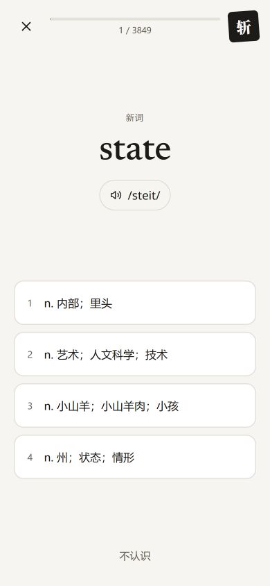
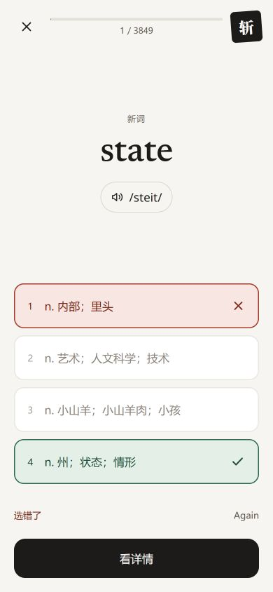
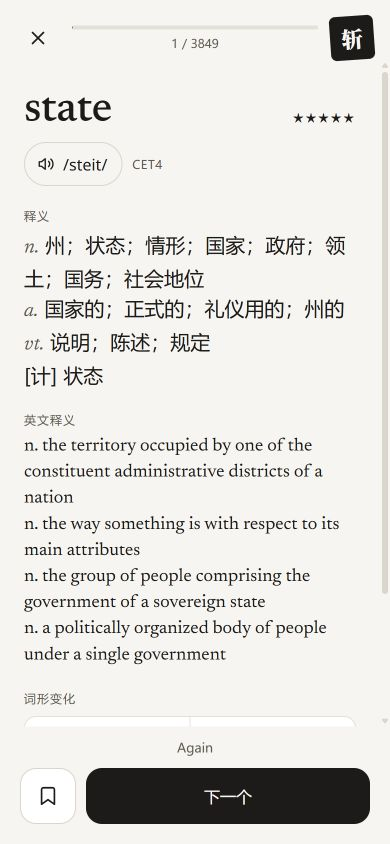

# M1 验收记录

验收日期：2026-11-02。范围为 CET4 认词、反馈、详情三屏及其内存交互，依据 `SPEC.md` 与 `design/html/02、03、04`。未实现 M2–M4。

## 已完成

- 三屏均保留顶部退出、进度和斩印，字体、间距、圆角与颜色参照 HTML；浅色、深色 tokens 包括新增的 faded-border、faded-num、star-empty。
- M1 状态统一为“新词”，评分只显示 Again / Hard / Good / Easy，不生成复习排期。详情生词本按钮禁用，保留位置和指定 aria-label。
- 详情内容可滚动，底部按钮固定；作答锁定、快答跳过详情、键盘操作、斩词及 3 秒撤销已实现。
- 干扰项逐级放宽词频和词性，每级保留释义重叠排除；不因候选不足跳词。核心数据解析索引在内存复用，避免每张卡重复解析整份词库。
- 选项只取第一个逻辑行的前 3 个义项，保留词性，统一用“；”连接；显示与重叠检查共用同一格式化函数。详情保留全部中文释义，只统一义项分隔符。选项 CSS 最多显示 2 行，超出省略。
- 安全区保底为顶部 16px、底部操作区 20px，系统安全区更大时使用系统值；SPEC 第 2、3.2、7.4 节已同步。
- 本地英语声音优先，缺少时允许非本地英语声音；声音列表延迟时等待，不因缺少本地声音直接显示不可用。
- README、AGENTS 和 packageManager 统一为本机 PATH 实际可用的 pnpm 11.25.0；该环境没有直接可用的 npm。

## 自动检查

| 检查 | 结果 |
|---|---|
| `pnpm install --frozen-lockfile` | 通过 |
| `pnpm test` | 8 个文件、49 项测试通过 |
| `pnpm test:wordlist` | 3 项 Python 测试通过 |
| `pnpm run build` | TypeScript strict 检查及 Vite 构建通过 |
| CET4 全词扫描 | 以第一逻辑行、前 3 义项的缩短文本重跑：3,849 / 3,849 均有 4 个选项、恰好 1 个正确项，且任意两项未触发重叠规则；见 `artifacts/m1/cet4-audit.json` |
| 字体校验 | 6 个 woff2 的复制文件与原文件 SHA-256 一致；构建产物包含全部 6 个字体 |
| 资源静态检查 | 应用的 fetch 使用同源 CET4 路径，CSS 字体 URL 全部为本地文件；构建 CSS 无外部 URL；完整 CSV 未进入构建 |
| 工程检查 | `git diff --check` 通过；应用样式未在 tokens.css 之外写裸色值；未使用 any |

测试覆盖评分边界和历史错答、词性和词频逐级放宽、各级释义冲突、候选组合回溯、不可组成选项时保留当前词、重复作答锁定、撤销到期及过期计时器、最后一词撤销、exchange 解析，以及延迟声音列表与远程英语声音回退。

提交前新增测试覆盖：首逻辑行与前 3 义项截取、复合词性前缀保留、括号内逗号不当作义项边界、详情不丢行/义项、重复格式化稳定，以及隐藏的后续义项不影响重叠判断、缩短后相同的选项仍被排除。

全词扫描使用固定随机函数验证候选可组成性与文字重叠规则，不代表人工审查了全部中文近义词。当前规则是文字启发式，不声称理解全部语义。

## 浏览器检查

在实际本地页面、390×844 viewport 下验证：

- 答错后所选项红色、正确项绿色、其他项淡化，全部选项锁定，评分 Again。
- 正确作答观察到 Easy（0.3 秒）、Good（4.7 秒）与 Hard（12.5 秒）三个分支。Easy/Good 主按钮为“下一个”并提供“看详情”；Hard 为“看详情”。
- 数字选项、0 不认识、回车与空格切换阶段、X 斩词均能工作。
- 斩词立即进入下一词；撤销保留当前卡与选项，把斩词放回当前卡之后；不撤销时提示在 3 秒后消失。
- state 的完整中文释义包含第 4 个逻辑行；详情滚动后可以访问完整词形网格，底部仍位于 viewport 的 844px 边界。生词本按钮为 disabled。
- 退出后继续保留状态；刷新返回初始入口，符合 M1 仅内存要求。
- 认词单词计算字号 52px、详情 44px；选项最小高 64px、圆角 14px、边框 1.5px。
- 本轮三屏重新截图：选项实际文本已缩短并统一分号，四项实测均为 64px 高；计算样式为 `-webkit-line-clamp: 2`、vertical、overflow hidden。顶部 padding 为 16px；两个底部操作区 padding-bottom 均为 20px，详情主按钮底边为 824px，滚动时底部仍固定。
- 1280×900 viewport 下，内容宽 480px，左右边界分别为 400px 和 880px。
- 刷新后的本地页面测试中未捕获控制台 error/warn。

三张截图已打开核对，文件实际像素均为 390×844，来自同一张真实 CET4 词卡 state：

| 认词 | 答错反馈 | 详情 |
|---|---|---|
|  |  |  |

## 与静态稿的差异及验收边界

- 使用真实 CET4 内容与真实进度，未照搬示例 mitigate、13/68 或其他考试标签；选项最多 2 行，详情长释义完整展示并可滚动。
- 按最新决定把原型固定的顶部/底部安全区留白改为 `max(16px, env(safe-area-inset-top))`、`max(20px, env(safe-area-inset-bottom))`，因此桌面 390×844 截图不会保留原型的 52px/30px 空白。
- 按本次决定，只显示评分、不显示排期；不实现原型“重选”；生词本按钮禁用。未新增完整首页、词表切换或设置页。
- 深色 token 已实现并逐项对照 SPEC；本次截图是浅色，未在真实设备深色模式下做视觉验收。
- 外部资源结论来自源码与产物检查，不是网络抓包。远程系统语音是已批准的例外，可能需要网络；实际扬声器播放、真实 iPhone Safari、安全区和手机局域网访问没有实机验证。
- M1 尚无 PWA 缓存，不能离线重新打开；部署与主屏幕安装体验留待 M4。

## Git

- 原始快照：`6e6bd90 M1 (old UI)`。
- 重复文件夹删除已独立提交：`227f9d0 Remove duplicate handoff folder`。
- 本轮三屏实现、提交前修订、截图与文档统一提交为 `M1: new UI per design`；原始 design、assets 和词表来源文件未更改。
